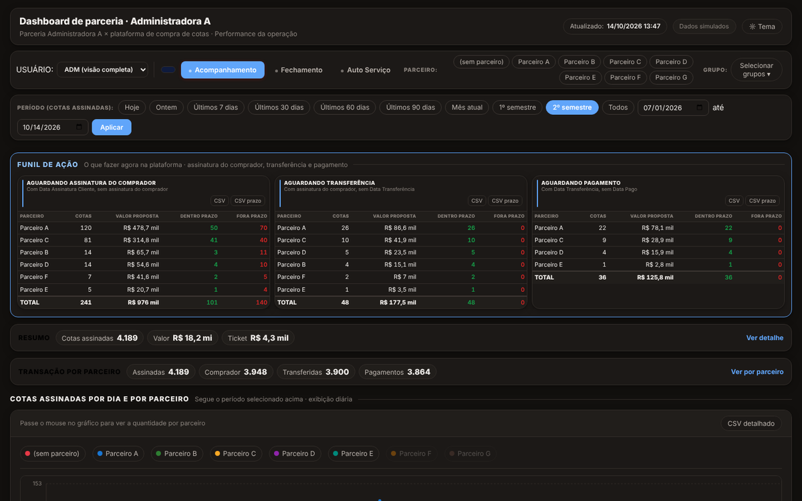

# Dashboard de parceria · Administradora A

Funil de ação (assinatura do comprador, transferência e pagamento), cotas assinadas por dia e por parceiro, fechamento, autosserviço e comparativo por grupo.

**[Abrir o painel →](https://vinimarrara.github.io/dashboard-parceria-a/)**

## Sobre
Versão de portfólio de um dashboard que construí para acompanhar uma parceria com administradora de consórcio numa plataforma de compra de cotas. O original roda em Google Apps Script, alimentado por um pipeline em Python a partir de bases no BigQuery.

**Todos os dados são simulados**: nomes de administradoras, parceiros, fundos e contratos são fictícios, e os volumes e valores foram gerados para manter apenas o comportamento da operação.

## Stack do original
Google BigQuery · SQL · Python · Google Apps Script · HTML/CSS/JavaScript (gráficos em SVG próprio)

---
Parte do portfólio de [Vinicius Marrara](https://vinimarrara.github.io/) · [LinkedIn](https://www.linkedin.com/in/vinicius-marrara-dos-santos-423b6973)
